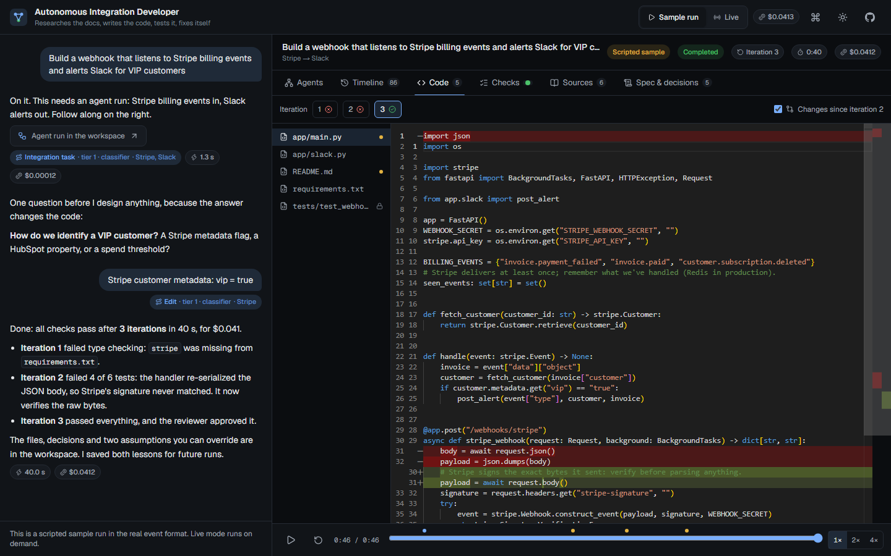
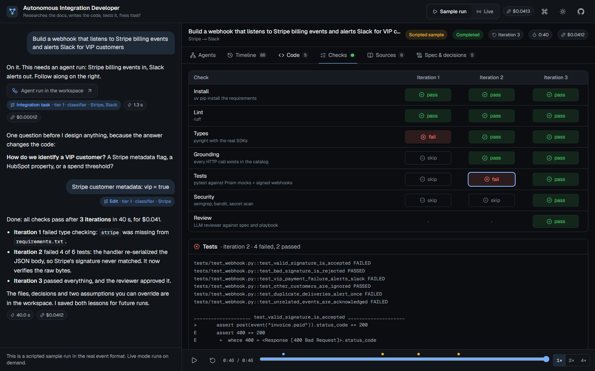
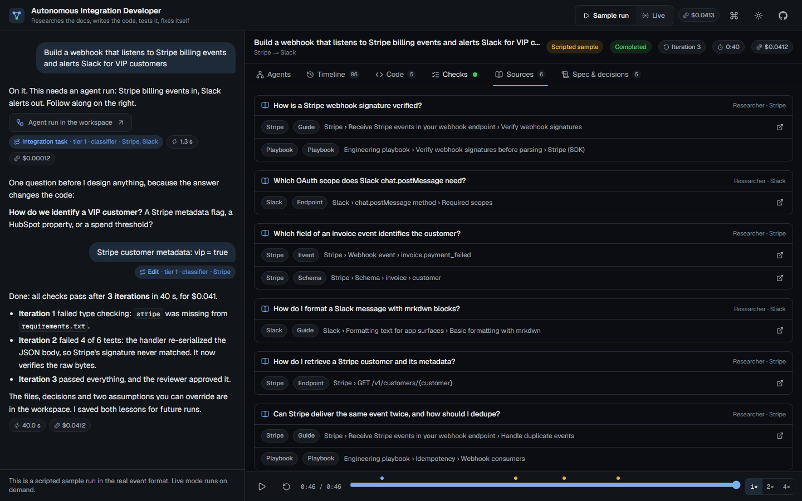
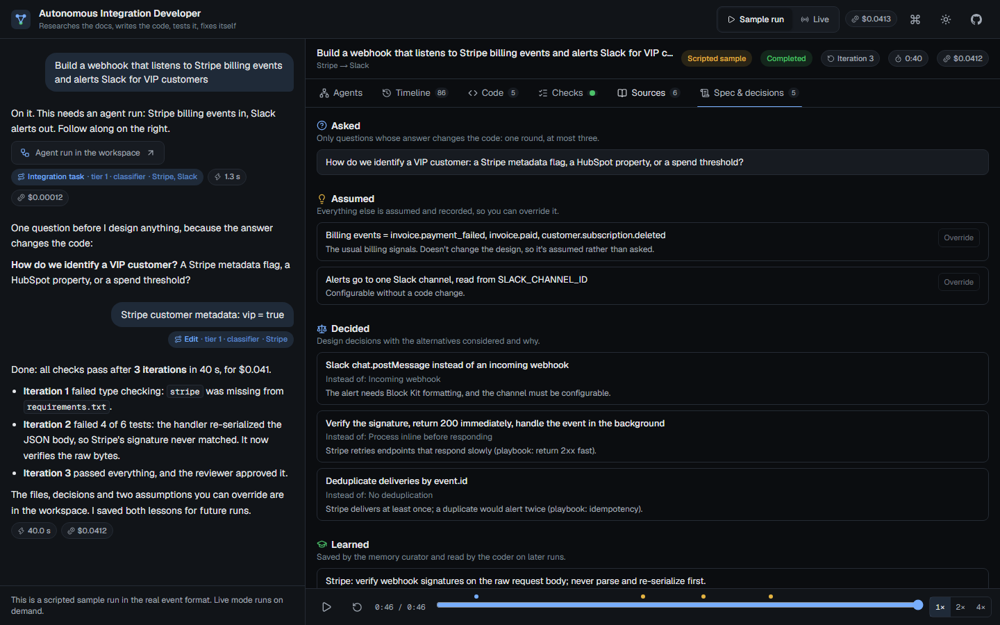
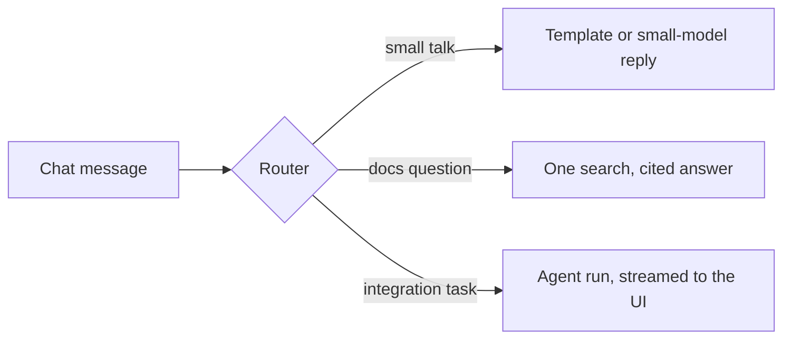
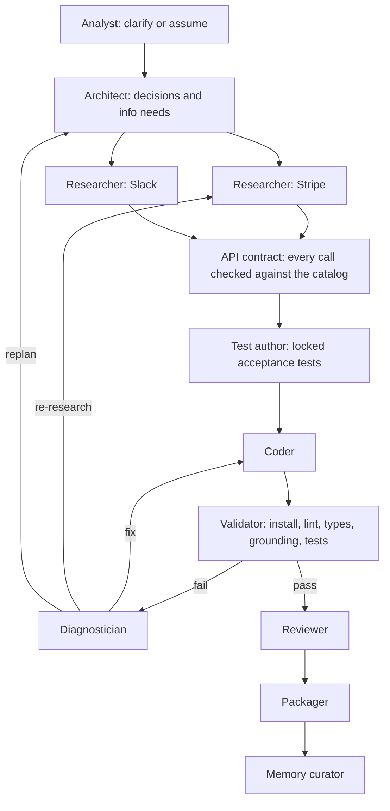

# Autonomous Integration Developer

[](https://github.com/Dima252/Autonomous-Integration-Developer/actions/workflows/ci.yml)


A chat-based virtual engineer that writes **and validates** API integrations.
Ask for *"Build a webhook that listens to Stripe billing events and alerts Slack for VIP
customers"*. It reads the real API docs, asks only the questions that change the design,
writes the code, tests it against mock APIs, and fixes its own mistakes until every
check passes. You watch each step as it happens.


<sub>The UI playing its scripted sample run, ~3.5× speed. The run is written in the
real [event format](docs/ui-events.md) the agents will emit (Phase 4); everything else
on this page, from the router to the docs search and the evals, is built and measured.</sub>

## Results so far

| What | Measured |
|---|---|
| Router accuracy | **111 / 111** on the golden set, typos and prompt-injection attempts included ([ADR 012](docs/decisions.md#012-router-rules-then-nearest-neighbour-in-parallel-with-a-haiku-classifier)) |
| Small-talk routing | **~0.3 s** p50, against ~1.3 s for an LLM classifier on every message |
| Docs retrieval | **Hit@8 0.98, MRR 0.92** on 66 queries; hybrid search measured *worse* and was rejected ([ADR 011](docs/decisions.md#011-docs-search-vector--reranker-by-default-bm25-as-fallback-chosen-by-eval)) |
| Cost per reply | **$0** for small talk (~30 ms), **~$0.001** for a cited docs answer, **$0.11** per 1,000 routed messages |
| Validator | **9 / 9** seeded bugs caught with no false alarms, **~4 s** per validation in a locked-down Docker sandbox ([ADR 019](docs/decisions.md#019-validation-sandbox-wheels-only-install-one-locked-down-container-per-check-a-seeded-bug-eval)) |
| Spend safety | Hard monthly caps, checked before every paid call, abandoned streams included ([ADR 013](docs/decisions.md#013-spend-metering-with-hard-monthly-caps-on-anthropic-and-voyage)) |
| Tests | Backend 142 unit + 17 integration + 12 sandbox, frontend 15 unit + Playwright end-to-end, all in CI |

## Inside a run

| | |
|---|---|
|  |  |
| **Code.** Every file at every iteration, with diffs. The acceptance tests are locked, so the coder can't weaken them to pass. | **Checks.** Deterministic checks first, an LLM reviewer last. Iteration 1 failed type checking, iteration 2 failed 4 tests. |
|  |  |
| **Sources.** Each research question and the provider docs or playbook pages that answered it. | **Spec and decisions.** One question asked, the rest assumed and open to override, decisions logged with their alternatives. |

## How it works



Most messages never reach the agents. A free rules tier and an embedding lookup answer
small talk, a small model classifies the rest, and only real integration tasks start a
run:



**Built and measured**
- **Cost-aware routing.** Rules, then a nearest-neighbour lookup in parallel with a Haiku
  classifier, so small talk is fast and everything else waits no longer than the
  classifier alone. Every paid call is metered against hard monthly caps.
- **Grounded RAG.** Provider OpenAPI specs are parsed into an exact *API catalog*
  (endpoints, webhook events, schemas), and the docs are searched by vector + reranker,
  with BM25 in SQL as the fallback when the embedding service is down. The configuration
  was chosen by eval, not by assumption.
- **Streaming chat API.** Typed Server-Sent Events: the route, citations, the answer and
  its cost. Run events go through Redis Streams to a resumable stream.
- **Validation sandbox.** Generated code is installed and checked in Docker containers
  with no network, a read-only workspace, no capabilities and resource limits. Packages
  install as wheels only, so no package code runs while the network is up. Ruff and
  pyright, with the real Stripe and Slack SDKs installed, catch invented packages,
  invented SDK methods and API misuse. A seeded-bug eval proves the checks work.
- **Mission-control UI.** The live agent graph, a timeline, code with per-iteration
  diffs, checks, sources, and the spec and decisions. One reducer folds events for live
  mode and replays alike.

**Designed, being built** ([roadmap](#roadmap))
- **Self-healing loop.** The remaining checks are an endpoint grounding check, pytest
  against Prism mock servers with signed webhook replays, and security scans. A
  diagnostician finds the root cause of each failure and routes it to a fix, more
  research, a replan, or a question for the user. The loop keeps the best version so far and stops on budget or
  when it stops making progress.
- **Agents that learn.** At most one round of clarifying questions, everything else
  assumed and recorded. A curated engineering playbook covers idempotency, signatures,
  retries and timeouts, and lessons from past runs carry over.

Design docs:
- [System architecture](docs/architecture.md): routing, RAG, validation, streaming, models, cost
- [Agent architecture](docs/agent-architecture.md): agents, blackboard state, the mechanisms behind them
- [Decision log](docs/decisions.md): 19 decisions with their context and trade-offs, for example:
  a fixed workflow with LLM decision points instead of a free-form supervisor (001),
  catalog grounding instead of vector search alone (006), and acceptance tests written
  before the code and locked (007)

## Stack

| Layer | Choice |
|---|---|
| Backend | Python 3.12, FastAPI, Pydantic, SQLAlchemy, Alembic, uv |
| LLMs | Claude Haiku / Sonnet / Opus 5.5 behind a provider-agnostic layer |
| Retrieval | Postgres + pgvector, BM25 in SQL, Voyage AI embeddings + reranker |
| Events / queue | Redis 7 (Streams; Arq from Phase 4) |
| Frontend | Next.js (static export), TypeScript, Tailwind, React Flow, Monaco, Motion |
| Testing | pytest, ruff, pyright, Vitest, Playwright, golden-set evals |
| CI / CD | GitHub Actions, images on GHCR, Lightsail VM over SSH |
| Sandbox | Docker (no network, read-only, wheels-only installs), ruff, pyright |
| Planned | Prism mocks (Phase 3), LangGraph (Phase 4), Langfuse + OpenTelemetry (Phase 6) |

## Quickstart

Prerequisites: Docker Desktop, [uv](https://docs.astral.sh/uv/), Node.js 24 (for the UI).

```bash
cp .env.example .env
docker compose up -d                 # Postgres (pgvector) + Redis

cd backend
uv sync
uv run alembic upgrade head          # create / update the database schema
uv run python -m aidev.catalog ingest  # load the API catalog (~10 s, downloads ~25 MB once)
uv run python -m aidev.rag index     # build the docs index (full-text search works now)
uv run python -m aidev.rag embed     # embed it (needs VOYAGE_API_KEY; resumable)
uv run python -m aidev.rag search "verify a stripe webhook signature" --provider stripe
uv run python -m aidev.router route "alert slack when a stripe dispute opens"  # needs ANTHROPIC_API_KEY
uv run python -m aidev.llm usage     # month-to-date spend against the monthly caps
uv run python -m aidev.validation build-image  # the sandbox image (needs Docker)
uv run python -m aidev.validation eval         # the validator against its seeded bugs
uv run uvicorn aidev.api.main:app --reload
# http://localhost:8000/health   http://localhost:8000/ready   http://localhost:8000/docs
```

The web UI (separate terminal). The sample run works with no backend at all:

```bash
cd frontend
npm install
npm run dev                          # http://localhost:3000 (API on :8000)
```

Chat over the API (Server-Sent Events):

```bash
curl -N localhost:8000/chat -H 'content-type: application/json' \
  -d '{"message": "how do I verify a stripe webhook signature?"}'
# event: route      data: {"intent": "docs_question", "tier": 1, ...}
# event: citations  data: {"hits": [{"n": 1, "title": ..., "url": ...}, ...]}
# event: delta      data: {"text": "Pass the raw request body, the Stripe-Signature ..."}
# event: done       data: {"cost_usd": 0.0006, "latency_ms": 4800, ...}
```

Checks (the same ones CI runs):

```bash
cd backend
uv run ruff check . && uv run ruff format --check . && uv run pyright
uv run pytest                        # unit tests
uv run pytest -m integration         # needs docker compose up
uv run pytest -m sandbox             # needs Docker and the sandbox image

cd ../frontend
npm run lint && npm run typecheck && npm test && npm run build
npm run e2e                          # Playwright on the static build, no backend
npm run media                        # re-record this README's GIF and screenshots
```

## Roadmap

- [x] **Phase 0: Foundation.** Repo layout, Docker services, health/readiness, CI
- [x] **Phase 1: RAG.** OpenAPI → API catalog, doc chunking, engineering playbook, search, retrieval eval
- [x] **Phase 2: Chat + UI.** Router, chat path, SSE event bus, the UI, and deployment
  - [x] LLM layer with hard monthly spend caps; two-tier router and its eval (ADR 012, 013)
  - [x] Chat API: template and model replies, cited docs answers, run events over
    resumable SSE, rate limits (ADR 014)
  - [x] Mission-control UI: chat, live agent graph, timeline, code diffs per iteration,
    checks, sources, spec and decisions; a scripted sample run (ADR 015)
  - [x] Live-mode server: Docker images, a Lightsail stack with HTTPS, CD over SSH
    (ADR 016)
  - [x] Showcase: the UI as a static build with an offline state, Playwright tests in
    CI, and this README's media recorded from it by a script (ADR 017, 018)
- [ ] **Phase 3: Sandbox + validation.** Docker sandbox, Prism mocks, and the deterministic
  checks, proven on hand-written good and bad code before any agent depends on them
  - [x] Sandbox: wheels-only install, one locked-down container per check; install,
    ruff and pyright; a seeded-bug eval in CI (ADR 019)
  - [ ] Prism mock servers, pytest with signed webhook replays, the grounding check
  - [ ] Security checks (bandit, secret scan), more seeded bugs, numbers
- [ ] **Phase 4: Agent graph + fix loop.** A thin slice first (analyst → researcher → coder →
  validator → diagnostician on one Stripe → Slack task), then the architect, contract
  compiler, test author, reviewer and packager
- [ ] **Phase 5: Recorded real runs.** Load exported runs into the replay view, and
  re-record this README from a real run in place of the scripted sample; assumption
  overrides, run history
- [ ] **Phase 6: Quality.** Memory, tracing, eval harness with ablations

## Deployment

Nothing runs all the time, so the project costs nothing while nobody is using it
(ADR 016, 018):

```
Real use     ──► docker compose, locally: UI, API, Postgres + pgvector, Redis

Live mode    ──► Lightsail (on demand) ──► Caddy ─┬─► UI (static files)
                                                  └─► FastAPI ─┬─► Postgres + pgvector
                                                               └─► Redis
```

- **Real use:** the full stack runs locally with `docker compose`.
- **Live mode, on demand:** the same stack on one Lightsail instance with 2 GB of RAM
  (~$12/month, billed by the hour), created for an interview or a live test and deleted
  afterwards. A VM, because platform hosts can't run the Docker sandbox that executes
  generated code. Setup and teardown: [infra/deploy/](infra/deploy/README.md).
- **Continuous deployment:** once CI passes on `main`, GitHub Actions builds both images
  and pushes them to GitHub Container Registry. While the live server exists, it also
  redeploys it over SSH.
- **Spend limits:** a monthly cap in the Anthropic console, hard per-month caps in the
  app (ADR 013), and per-IP rate limits.
- **Showcase:** this README. Its media is generated from the static build
  (`npm run media`), so it is re-recorded rather than hand-captured.

## Repository layout

```
docs/                 Architecture, agent design, decision log, UI event contract, README images
frontend/             Next.js mission-control UI (see frontend/README.md)
  e2e/                Playwright tests and the static server they run against
  scripts/media.mjs   Records the README's GIF and screenshots
backend/              Python backend (package: aidev)
  src/aidev/api/      FastAPI gateway: health, chat and run-event endpoints (SSE)
  src/aidev/chat/     Chat path: conversations, replies, docs answers, run creation
  src/aidev/events/   Typed run events on Redis Streams
  src/aidev/catalog/  API catalog: OpenAPI parser, provider profiles, store, ingest CLI
  src/aidev/rag/      Docs index: corpus, chunking, embeddings, BM25 + vector search, eval
  src/aidev/llm/      LLM client interface, Claude adapter, pricing, spend meter and caps
  src/aidev/router/   Two-tier router: rules, nearest neighbour, classifier, eval
  src/aidev/validation/  Sandbox runner, checks, staged validator, seeded-bug eval
  src/aidev/infra/    Postgres / Redis clients
  migrations/         Alembic database migrations
corpus/playbook/      Engineering playbook (indexed alongside provider docs)
corpus/router/        Labeled example messages for the router's tier 0
corpus/eval/          Golden sets for evaluation
corpus/validation/    Reference solution and seeded bugs for the validator
infra/postgres/       DB init scripts (pgvector)
infra/sandbox/        Validation sandbox image: tools, ruff and pyright config
infra/deploy/         Live-mode compose stack, Caddyfile, VM scripts, runbook
.github/workflows/    CI with end-to-end tests; image builds and the live-mode deploy
```
